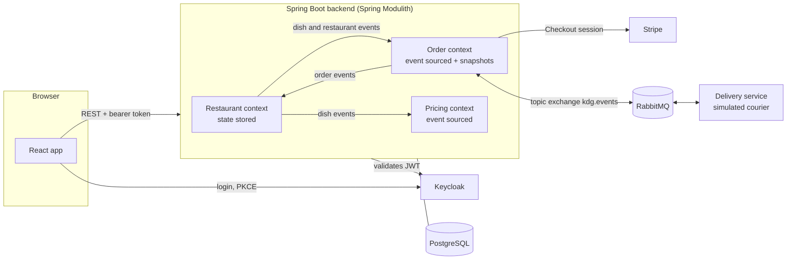

# Keep Dishes Going

A food-ordering platform where **customers** order from local restaurants without creating an
account, **restaurant owners** manage their menu and incoming orders, and an **admin** decides
what counts as a cheap or an expensive restaurant, including for dates already in the past.

Built solo as the Programming 6 project at Karel de Grote University of Applied Sciences (KdG),
and polished afterwards for this portfolio. The backend has three DDD bounded contexts that only
talk to each other through events. Orders use event sourcing, and price ranges are recalculated
from event history so retroactive changes give correct results.

<!-- Screenshots: customer flow, owner dashboard, price range graph -->

## Tech stack

| | |
|---|---|
| **Backend** | Java 17, Spring Boot 3.5, Spring Modulith, Spring Data JPA, Spring Security (OAuth2 resource server), Spring AMQP |
| **Frontend** | React 19, TypeScript, Vite, MUI, TanStack Query, React Hook Form with Zod, Leaflet, MUI X Charts |
| **Infrastructure** | PostgreSQL, RabbitMQ, Keycloak, Stripe Checkout, Docker Compose |

## Architecture



- **Restaurant**: restaurants, dishes, drafts, scheduled publishes, stock, opening hours.
- **Order**: basket checkout, payment, accept/reject, auto-decline after five minutes, delivery
  tracking. This is the only context that talks to the outside world.
- **Pricing**: the price range criteria and each restaurant's price history.

The full context map, the domain model and the command and event catalogs are in
[`backend/documentation/`](backend/documentation/).

## Key engineering decisions

**Hexagonal architecture inside Spring Modulith modules.** Each context is an
`@ApplicationModule` with `domain`, `core` (use cases and ports) and `adapter` packages. Business
rules live in the domain classes. For example, `RestaurantMenu` enforces the limit of ten
available dishes, and `OrderStatus` decides which transitions are allowed.

**Contexts communicate only through events.** Pricing needs dish prices, but it never reads the
restaurant tables. It builds its own small read model from the dish events it receives. The
order context keeps projections of dishes and restaurants in the same way.

**Event sourcing on `Order`**, with a snapshot every 50 events. Every state change, from placed and
paid through accepted, picked up and delivered, is stored as a fact. The aggregate is rebuilt by
replaying those facts on top of the latest snapshot, and read models are projected from them.

**Event sourcing on `PriceRangeCriteria`, so it can change retroactively.** An admin can change
what "cheap" means from a date in the past. Storing a price range per restaurant would make all
of that history wrong, so it is never stored. Each read combines the restaurant's price history
with the criteria history.

**Customers stay anonymous, and tokens stay in memory.** Only owners and admins sign in, through
Keycloak with PKCE. The access token is never written to browser storage. After a page reload,
Keycloak's own SSO cookie issues a new one.

**Every external service can be swapped for a local stand-in.** The course provided a delivery
service, and a small Node simulator in `backend/infrastructure/delivery-simulator/` now plays
that role over the same RabbitMQ contract. If no Stripe key is configured, the app shows a
simulated payment page that goes through the same confirmation use case as a real Stripe
callback.

## Quick start

You only need Docker Desktop.

```bash
git clone https://github.com/meganekarol/keep-dishes-going.git
cd keep-dishes-going/backend/infrastructure
docker compose --profile full up -d --build
```

The first build takes a few minutes, and Keycloak needs about two more minutes on its first
boot. Then open **http://localhost:5173**.

| As | Sign in with | Try |
|---|---|---|
| Customer | nothing, guests order without an account | Browse the list or map, fill a basket, check out |
| Owner | `owner` / `owner` | Accept the order, then mark it ready for pickup |
| Admin | `kdg-admin` / `kdg-admin` | Adjust the price range criteria, load demo history for the graph |

Four demo restaurants are seeded on first start. After the owner marks an order ready, the
simulated courier delivers it in about 40 seconds, and the tracking page follows along.

To pay through real Stripe test checkout (card `4242 4242 4242 4242`), or to run the backend and
frontend outside Docker for development, see
[`backend/documentation/getting-started.md`](backend/documentation/getting-started.md).

## Repository layout

```
backend/    Spring Boot application, documentation, Docker Compose infrastructure
frontend/   React client
```

Each folder has its own README with the details and what I learned building it:
[backend](backend/README.md) · [frontend](frontend/README.md).
