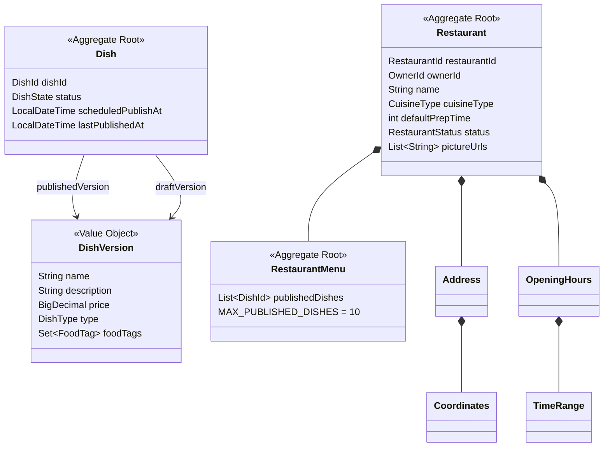
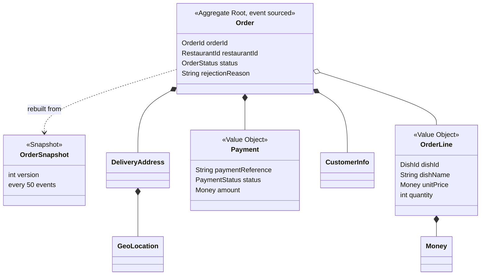
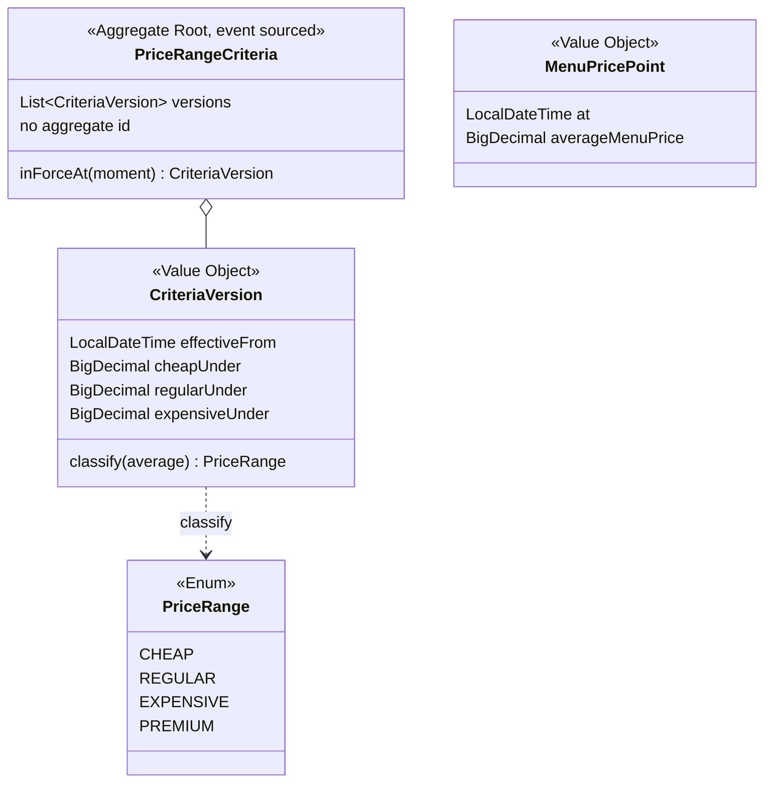

# Domain model

Three bounded contexts, each a Spring Modulith `@ApplicationModule`. See
[`README.md`](README.md) for the context map and [`event-catalog.md`](event-catalog.md) for
what crosses between them.

Two of the three are event sourced, for different reasons, and one is not. That is the
distinction worth understanding first.

| Context | Persistence | Why |
|---|---|---|
| `restaurant` | State stored, JPA | A menu is a thing you look at now. Nobody asks what a dish cost last March. |
| `order` | Event sourced, snapshotted every 50 events | An order's history *is* the product: US-24 and US-25 ask the customer to watch it move. |
| `pricing` | Event sourced, no snapshots | The admin can change the past (US-32), so nothing may be overwritten. The log is short enough to replay whole. |

---

## Restaurant context



**Value objects:** `Address`, `Coordinates`, `CuisineType`, `DishId`, `DishState`, `DishType`,
`DishVersion`, `FoodTag`, `OpeningHours`, `OwnerId`, `RestaurantId`, `RestaurantStatus`,
`TimeRange`.

### Why `Dish` holds two versions

`publishedVersion` is what customers see; `draftVersion` is what the owner is working on and is
null when nothing is pending. That pair is what makes US-03 possible: an owner edits a live dish
without customers seeing half-finished changes. Publishing promotes the draft; US-06 promotes
every pending draft at once, and US-07 books that promotion for later via `scheduledPublishAt`.

### Why `RestaurantMenu` is a separate aggregate root

US-27 caps a restaurant at ten dishes available to customers at any time. That is a rule about
the *menu*, not about any one dish, and a `Dish` cannot enforce it because it cannot see its
siblings. So publishing goes through `RestaurantMenu`, which owns `publishedDishes` and refuses
the eleventh.

### Open or closed

`RestaurantStatus` is not a plain flag. A restaurant follows its `OpeningHours` by default, and
an owner can override with a manual open or close (US-09), or hand the doors back to the
schedule. Three commands, one field.

---

## Order context



**Value objects:** `CustomerInfo`, `DeliveryAddress`, `DishId`, `GeoLocation`, `Money`,
`OrderId`, `OrderLine`, `OrderStatus`, `Payment`, `PaymentStatus`, `RestaurantId`.

### The status machine

`OrderStatus` carries its own rules rather than leaving them to a service:

```text
AWAITING_PAYMENT ──pay──▶ PENDING_ACCEPTANCE ──accept──▶ ACCEPTED ──ready──▶ READY_FOR_PICKUP
       │                          │                                                │
       │ 5 min                    │ reject, or 5 min                          picked up
       ▼                          ▼                                                ▼
 PAYMENT_EXPIRED             REJECTED                                        IN_DELIVERY
                                                                                   │
                                                                                   ▼
                                                                              DELIVERED
```

`isVisibleToRestaurant()` is what keeps an unpaid order out of the owner's list and out of the
busyness count of US-19: a kitchen is never told about an order nobody has paid for.

### Why `OrderLine` copies the dish name and price

An order is priced off the menu the customer was actually shown. Copying the name and unit price
at checkout means a later repricing cannot rewrite what someone already agreed to pay.

### Projections

The Order context keeps its own read models of things it does not own: `DishProjection` and
`RestaurantProjection`, built from Restaurant's events. That is why it can validate an order
without ever calling the Restaurant context.

---

## Pricing context



**Value objects:** `CriteriaVersion`, `MenuPricePoint`, `PriceRange`.

### One aggregate, no id

There is one price policy for the whole platform, not one per restaurant. So the aggregate has
no identifier and its event log needs no aggregate column: the sequence number alone orders it.

### The retroactive part

`apply()` adds a version then re-sorts every version by `effectiveFrom`. Events replay in the
order they were *recorded*, but sort into the order they *take effect*, so a version appended
today with July's date is the last event in the log and the middle entry in the list. That one
line is US-32.

A restaurant's band is never stored. `ViewPriceRangeEvolutionQueryImpl` computes it on every
read by merging two timelines: the restaurant's recorded menu averages, and the criteria
versions. A back-dated threshold change therefore rewrites every restaurant's graph at once,
with no projection to rebuild and nothing that can go stale.

---

## Shared kernel

`common/events` holds the events every context agrees on, plus `OpeningHoursSlot`, a plain-JDK
form of one day's opening window. Contexts never import each other's value objects, so anything
crossing a boundary is reduced to JDK types first. `common/exceptions` holds `DomainException`
and its subclasses.
